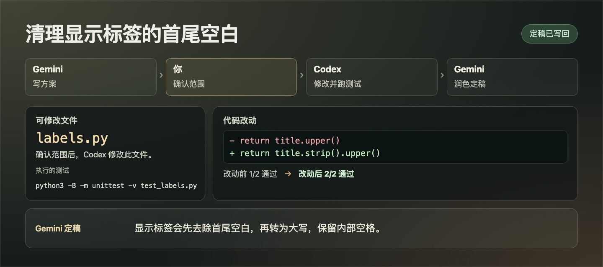

<p align="center"><strong>简体中文</strong> · <a href="docs/README.en.md">English</a></p>

<h1 align="center">Agent Handoff Cards</h1>

<p align="center">Gemini 拟方案，Codex 改代码并跑测试，Gemini 根据结果写定稿。</p>
<p align="center">方案、你确认的文件范围和测试结果，都留在同一张本地卡片里。</p>

<p align="center">
  <strong><a href="https://github.com/Fanmili-5/agent-handoff-cards/releases/download/v0.1.0-alpha.2/agent-handoff-cards-v0.1.0-alpha.2-source.zip">下载源码 ZIP</a></strong>
  · <a href="#快速上手">快速上手</a>
  · <a href="#命令行与-skill">CLI 与 Skill</a>
</p>

<p align="center"><sub>macOS · 工作台 / CLI / Skill · <a href="https://github.com/Fanmili-5/agent-handoff-cards/releases/tag/v0.1.0-alpha.2">v0.1.0-alpha.2</a></sub></p>

<p align="center"><a href="docs/handoff-overview-zh.jpg"></a></p>

*一次真实交接。Codex 只改了 `labels.py`，测试从 1/2 通过变为 2/2。点图放大。*

## 快速上手

需要 macOS 13+、Python 3.9+ 和 Xcode Command Line Tools。下载并解压后，在源码目录运行：

```bash
python3 -B workbench.py
```

首次运行会构建并打开 `dist/Agent Handoff.app`。选择两个客户端都能访问的项目，新建一张卡，填入目标和可修改的相对路径。只交付文字时，文件范围留空。

每段指令由你发送。两个客户端使用各自已有的登录，工作台无需配置 API key。

## 交接流程

1. **Gemini 拟方案。** 从工作台复制构思指令，发到 Antigravity。方案写回卡片。
2. **你确认范围。** 核对初稿和文件清单，点击「确认执行范围」。
3. **Codex 改代码、跑测试。** 发送执行指令。Codex 按确认范围执行，并写回实际改动和测试结果。
4. **Gemini 润色定稿。** 把润色指令发回 Antigravity，Gemini 根据报告写说明。回到工作台即可复制定稿。

## 命令行与 Skill

```bash
python3 -B handoff.py --workspace /path/to/project new \
  --title '整理发布说明' --goal '核实启动命令并更新 README' --scope README.md
python3 -B handoff.py --workspace /path/to/project prompt CARD
```

把 `CARD` 换成创建时返回的卡号。工作台提示带有 CLI 和 Skill 的绝对路径，工具源码可以放在项目之外。用命令行确认时，先执行 `show CARD` 阅读初稿、范围和 `digest`，再执行 `approve CARD --digest DIGEST`。阶段结果可通过标准输入或 `--file` 写回。 [交接卡 Skill](.agents/skills/agent-handoff/SKILL.md)

## 本地数据与兼容性

卡片写在项目的 `.agent-handoff/`，请将此目录加入 Git 的本地排除清单。确认记录绑定初稿和文件清单。发送指令后，各客户端按权限读取材料并使用自己的模型服务。

已在 Apple Silicon、macOS 26.5.1 上验证。其他 macOS 版本和 Intel Mac 待测。

```bash
python3 -B -m unittest discover -s tests
python3 -B workbench.py --build-only
```

[MIT 许可](LICENSE) · [Release 与校验文件](https://github.com/Fanmili-5/agent-handoff-cards/releases/tag/v0.1.0-alpha.2)
