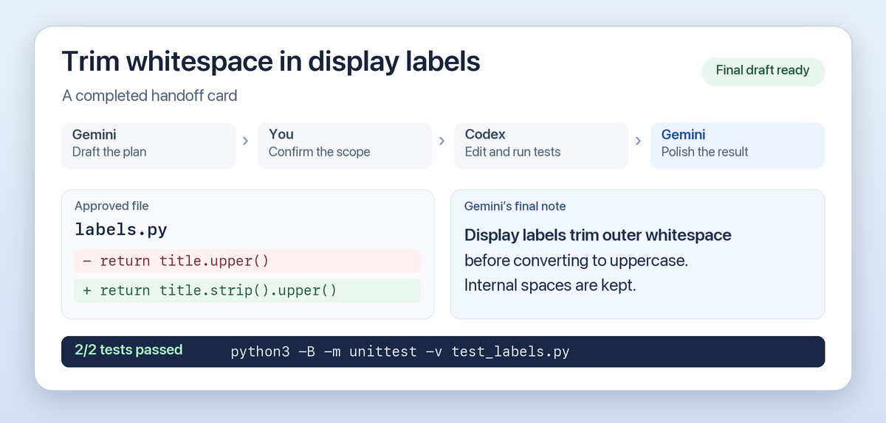

# Agent Handoff Cards

[English](docs/README.en.md)

**Gemini 写方案，Codex 改代码，测试结果回到同一张卡。**

在 macOS 上把一个任务交给两个常用客户端。你先确认方案和可修改的文件，再让 Codex 执行。Gemini 最后根据真实结果写说明，交接过程中不用重新整理整段聊天。

[下载源码 ZIP](https://github.com/Fanmili-5/agent-handoff-cards/releases/download/v0.1.0-alpha.2/agent-handoff-cards-v0.1.0-alpha.2-source.zip) · [查看 Release](https://github.com/Fanmili-5/agent-handoff-cards/releases/tag/v0.1.0-alpha.2) · [快速上手](#快速上手)



*上图根据实际完成的一张交接卡绘制。Codex 只改了 `labels.py`，Gemini 根据两项通过的测试写回了用户能读懂的说明。*

## 快速上手

需要 macOS 13+、Python 3.9+ 和 Xcode Command Line Tools。下载并解压源码，在解压目录运行：

```bash
python3 -B workbench.py
```

首次运行会构建并打开 `dist/Agent Handoff.app`。选择两个客户端都能访问的项目，写下目标和可修改的相对文件路径。只交付文字时，文件清单留空。

1. **Gemini 构思。** 把工作台里的构思指令发到 Antigravity，等它写回方案。
2. **你确认。** 在工作台核对初稿和文件清单，点「确认执行范围」。
3. **Codex 执行。** 发送执行指令，让 Codex 改代码、跑检查并写回结果。
4. **Gemini 润色。** 把润色指令发回 Antigravity。定稿写进同一张卡，可在工作台复制。

每一步由你发送指令。Codex 和 Antigravity 使用各自已有的登录，工作台无需配置 API key 或安装 Hub 补丁。

## 命令行与 Skill

```bash
python3 -B handoff.py --workspace /path/to/project new \
  --title '整理发布说明' --goal '核实启动命令并更新 README' --scope README.md
python3 -B handoff.py --workspace /path/to/project prompt CARD
```

把 `CARD` 换成创建时返回的卡号。工作台提示带有 CLI 和 Skill 的绝对路径，工具源码可以放在项目之外。如客户端询问读取权限，只需允许访问用到的工具文件。 [交接卡 Skill](.agents/skills/agent-handoff/SKILL.md)

从终端确认时，先用 `show CARD` 核对初稿、范围和 `digest`，再执行 `approve CARD --digest DIGEST`。`draft`、`report` 和 `polish` 支持标准输入和 `--file`。

## 数据与兼容性

卡片保存在项目的 `.agent-handoff/`。请把该目录加入 Git 的本地排除清单。确认记录绑定初稿和文件清单。指令发出后，各客户端按其权限读取项目文件并使用自己的模型服务。

已在 Apple Silicon、macOS 26.5.1 上验证。其他 macOS 和 Intel Mac 待测。

```bash
python3 -B -m unittest discover -s tests
python3 -B workbench.py --build-only
```

[MIT 许可](LICENSE)
