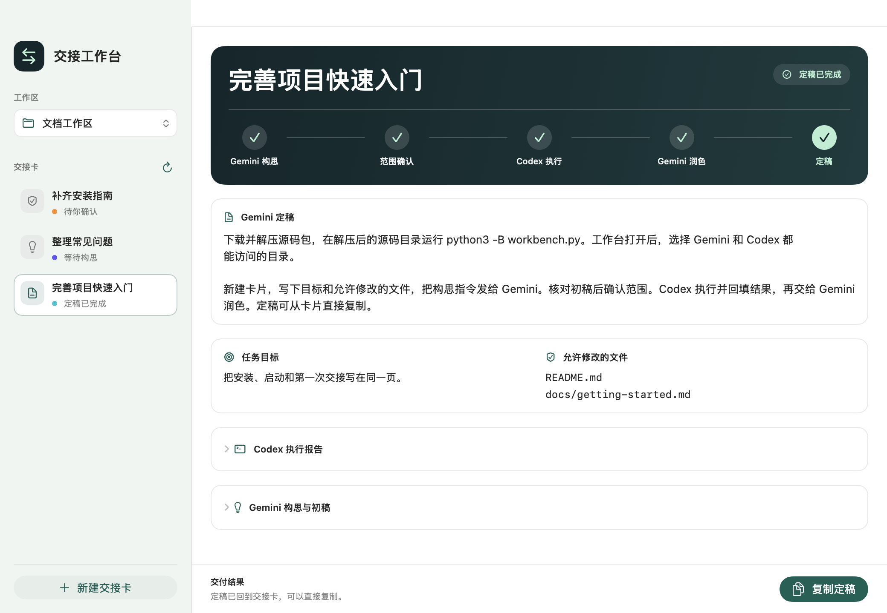

<p align="center"><a href="../README.md">简体中文</a> · <strong>English</strong></p>

<h1 align="center">Agent Handoff Cards</h1>

<p align="center">Gemini drafts the plan. Codex edits and tests. Gemini polishes the result.</p>
<p align="center">One local card holds the draft, the files you approve, and the checks Codex ran.</p>

<p align="center">
  <strong><a href="https://github.com/Fanmili-5/agent-handoff-cards/releases/download/v0.1.0-alpha.3/agent-handoff-cards-v0.1.0-alpha.3-source.zip">Download source ZIP</a></strong>
  · <a href="#quick-start">Quick start</a>
  · <a href="#cli-and-skill">CLI and Skill</a>
</p>

<p align="center"><sub>macOS · Workbench / CLI / Skill · <a href="https://github.com/Fanmili-5/agent-handoff-cards/releases/tag/v0.1.0-alpha.3">v0.1.0-alpha.3</a></sub></p>

<p align="center"><a href="workbench.png"></a></p>

*The macOS workbench showing a completed sample card. The app interface is in Chinese.*

## Quick start

Requires macOS 13 or later, Python 3.9+, and Xcode Command Line Tools. If you need the command line tools, run `xcode-select --install` first.

Download the **source ZIP** above and unzip it. In Terminal, go to the extracted `agent-handoff-cards-v0.1.0-alpha.3` folder and run:

```bash
python3 -B workbench.py
```

The first launch builds and opens `dist/Agent Handoff.app`. Select a project both clients can access. Create a card with the goal and the relative paths Codex may edit. Leave the file scope empty for a writing-only task.

You send each prompt. Both clients use their existing sign-ins. The workbench requires no API key.

## The handoff

1. **Gemini drafts the plan.** Copy the planning prompt from the workbench and send it in Antigravity. The draft goes back on the card.
2. **You approve the scope.** Review the draft and file list, then confirm in the workbench.
3. **Codex edits and tests.** Send the execution prompt. Codex uses the approved scope and records what changed and which checks passed.
4. **Gemini polishes the note.** Send the editing prompt in Antigravity. Copy the final wording from the same card.

## CLI and Skill

```bash
python3 -B handoff.py --workspace /path/to/project new \
  --title 'Update release notes' --goal 'Verify setup and update the README' --scope README.md
python3 -B handoff.py --workspace /path/to/project prompt CARD
```

Use the ID returned by `new` in place of `CARD`. Workbench prompts include absolute paths to the CLI and Skill, so the tool can live outside the task project. To approve in a terminal, review the draft, file scope, and digest with `show CARD`, then run `approve CARD --digest DIGEST`. Write back each stage via standard input or `--file`. [Handoff Skill](../.agents/skills/agent-handoff/SKILL.md)

## Local data and compatibility

Cards live in the project's `.agent-handoff/` directory. Add it to your local Git exclude list. An approval records the draft and file scope. When you send a prompt, each client uses its own permissions and model service.

Tested on Apple Silicon with macOS 26.5.1. Other macOS versions and Intel Macs are unverified.

[MIT license](../LICENSE) · [Release notes and checksum](https://github.com/Fanmili-5/agent-handoff-cards/releases/tag/v0.1.0-alpha.3)
